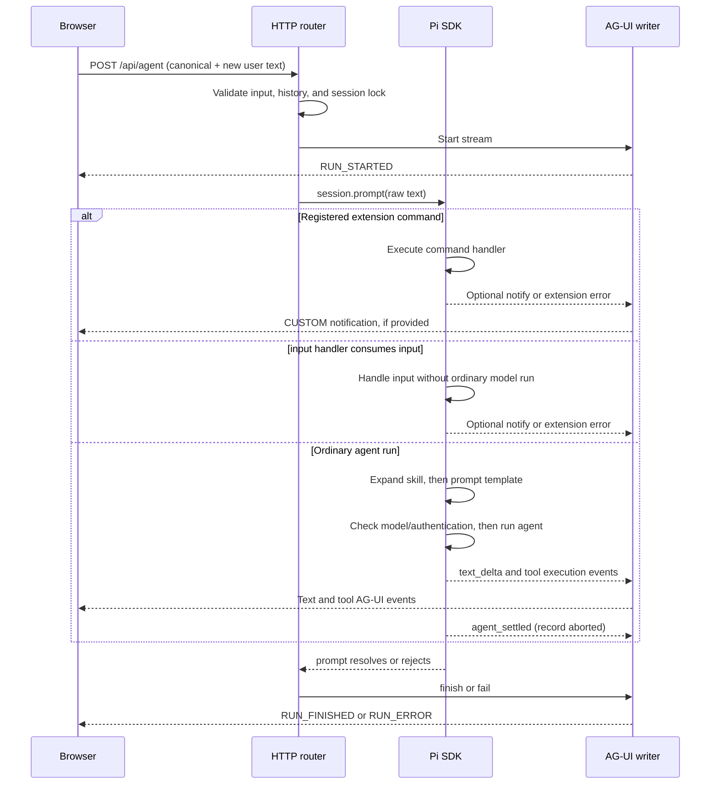

# Pi App

> **BREAKING CHANGE:** Pi App moves from **Pi RPC + Tauri desktop app** to **Pi SDK + AG-UI + web**.
> The current version runs in your browser, not in a native desktop window.
> To keep the previous desktop app, install a specific older version:
>
> ```sh
> pi install npm:pi-native-app@0.1.15
> ```
>
> The npm package name remains `pi-native-app`.
> See the [changelog](CHANGELOG.md) for migration details and the refactor summary.

Pi App is a local web client for the [Pi coding agent](https://github.com/earendil-works/pi/tree/main/packages/coding-agent).
It runs the Pi TypeScript SDK inside a Node.js service and streams selected events through AG-UI 1.0.
It does not launch `pi --mode rpc` or require a native desktop runtime.

**Pi owns model context and persisted history.** The browser owns presentation, drafts, and display-only notifications.
AG-UI carries runs. Separate HTTP APIs carry workspace, session, history, command discovery, tags, and clipboard images.

## Breaking change: desktop to web

This is an architecture replacement, not an update to the Tauri desktop app.
The previous app used Pi RPC and a Tauri native desktop runtime.
The current app runs the Pi TypeScript SDK in a Node.js service and uses AG-UI to stream events to a browser.
It no longer ships the Tauri runtime, Rust binaries, platform installers, or a Pi RPC launcher.

To keep the old desktop experience, pin an older release with the installation command above.
To use the current web app, follow [Start here](#start-here).

### Refactor size

The refactor PR reports **+6,490 / -21,101 lines**, for a **net reduction of 14,611 lines**.
It removes substantially more code than it adds while replacing the native desktop and RPC architecture.
These figures are PR diff line counts, not a measurement of total source code or runtime performance.

## Start here

You need Node.js 22.19 or later, plus configured Pi models and credentials.
The server uses `--experimental-strip-types`. Configure model access in Pi before you submit a model request.

### Run from source

```sh
npm install
npm run dev
```

Open <http://127.0.0.1:1420>. The initial workspace is your launch directory.

For a production build:

```sh
npm run build
npm start
```

The production service serves `desktop/dist` and the API from the same local origin.

### Run as a Pi package

```sh
pi install npm:pi-native-app
cd /absolute/path/to/project
pi
```

Then run this command **in Pi**, not in the web composer:

```text
/app
```

`/app` starts a production service when needed, selects the current Pi workspace, and opens your browser.
It uses `127.0.0.1:1420` and leaves the service running after the command finishes.
A healthy existing service is reused. `/app` does not reload changed backend code.
Workspace selection fails while any web run is active.

## Explore the event map

In a source checkout, open the [self-contained event map](desktop/public/pi-agui-map.html) directly in a browser.
With Pi App running, open <http://127.0.0.1:1420/pi-agui-map.html>.
The production build copies the same HTML file into `desktop/dist`.

The map shows the current implementation, not every event supported by the AG-UI specification.
It distinguishes SDK events, extension feedback, prompt preprocessing, and HTTP side routes.
Select a scenario to inspect its sequence and payload changes. The page needs no external scripts or model requests.

## Architecture

```text
Browser
├── React conversation, sidebar, composer, and per-session state
├── PiClient
│   ├── @ag-ui/client HttpAgent → POST /api/agent → SSE
│   └── HTTP → workspace, sessions, history, commands, tags, images, abort
└── Markdown, math, Mermaid, tool results, and extension notifications

Local Node.js service
├── HTTP router and active-run locks
├── AgUiEventWriter → AG-UI events
├── SessionRegistry
│   ├── SessionManager → persisted Pi JSONL session branch
│   ├── DefaultResourceLoader → extensions, skills, prompt templates
│   ├── AgentSession.prompt → Pi execution and model/tool lifecycle
│   └── ExtensionFeedback → notify and explicit extension errors
├── AppStore → tag metadata
└── Clipboard image storage → private temporary files
```

SSE means server-sent events: the server sends JSON events over one HTTP response.
The SDK runs in the service process. `mode: "rpc"` describes the extension UI context, not a subprocess transport.

`SessionRegistry` adds codemode, tool search, and Model Context Protocol (MCP) extensions.
It enables `codemode` and `tool_search` through settings overrides.
The normal Pi resource loader supplies global and workspace resources, subject to Pi configuration and trust rules.

Sources: [HTTP router](desktop/server/index.ts), [session registry](desktop/server/session-registry.ts),
[client](desktop/src/pi-client.ts), and [React page](desktop/src/App.tsx).

## How a run starts

The client fetches canonical messages before submitting each run.
The visible, paginated chat history is not the request's authority.

```text
canonical = GET /api/sessions/:id/messages
input.messages = canonical + one new user message
POST /api/agent(input)

server:
  parse RunAgentInputSchema
  reject an active run for the same session
  compare input.messages except the final message with canonical
  require the final message to be a user message
  extract text and open the Pi session
  start SSE and emit RUN_STARTED
  subscribe to extension feedback
  await AgentSession.prompt(text)
  finish or fail the AG-UI stream
  remove subscriptions and the active-run lock
```

The comparison uses deep structural equality. Object key order does not matter; message order and nested values do.
Changed message IDs, content, tool-call IDs, arguments, or error metadata still fail validation.

The AG-UI `threadId` identifies a Pi session. `runId` identifies one web request.
Live assistant and result message IDs are generated by the adapter. Canonical message IDs come from persisted Pi entries.
Tool-call IDs remain the Pi tool-call IDs.

The service extracts text from the final message. It does not pass AG-UI `state`, `context`, `tools`, or `forwardedProps` into Pi.
Pi configuration controls tools and model context. Mixed input content contributes text only; image-only content is not accepted.

Sources: [PiClient.runAgent](desktop/src/pi-client.ts),
[parseRunInput, assertCanonicalHistory, and promptFromInput](desktop/server/agui-adapter.ts).

## Pi → AG-UI mapping

The adapter is selective. Most Pi lifecycle events have no direct AG-UI equivalent in this implementation.

| Input or trigger                                       | AG-UI output                                           | Meaning and limits                                                               |
| ------------------------------------------------------ | ------------------------------------------------------ | -------------------------------------------------------------------------------- |
| HTTP wrapper starts the stream                         | `RUN_STARTED`                                          | Generated before `session.prompt()`. Not a translation of `agent_start`.         |
| `message_update` with `text_delta`                     | `TEXT_MESSAGE_START`, then `TEXT_MESSAGE_CONTENT`      | The first delta opens a generated assistant message. Later deltas append text.   |
| A tool starts, or the writer finishes/fails            | `TEXT_MESSAGE_END`, if text is open                    | Generated by the writer. Not a translation of Pi `message_end`.                  |
| `tool_execution_start`                                 | `TOOL_CALL_START` → `TOOL_CALL_ARGS` → `TOOL_CALL_END` | One complete JSON argument string. `END` closes arguments, not execution.        |
| `tool_execution_end`                                   | `TOOL_CALL_RESULT`                                     | Text projection of the result. `isError` adds `error: "Tool execution failed"`.  |
| Extension `ctx.ui.notify(message, level)`              | `CUSTOM` named `pi.notification`                       | Display-only feedback with `message` and `level`. Not a Pi model message.        |
| An extension error buffered before subscription        | Error-level `pi.notification`                          | Does not fail the next unrelated run.                                            |
| An extension error during the subscribed run           | `RUN_ERROR` when the writer finishes                   | The bridge records errors even when the SDK catches the exception.               |
| `agent_settled`                                        | No immediate event                                     | The adapter records `aborted`. Completion still waits for `prompt()` to resolve. |
| `session.prompt()` resolves and writer checks pass     | `RUN_FINISHED`                                         | `outcome.type` is `success` or `cancelled`, based on the recorded abort flag.    |
| `session.prompt()` rejects, or writer completion fails | `RUN_ERROR`                                            | Ends the SSE response with a message.                                            |

The tool-call `parentMessageId` is the open live text message ID, when one exists.
A tool call without preceding streamed text can have no parent message ID.
`tool_execution_update` is not forwarded. Tool arguments are not streamed from `toolcall_delta`.

These events are also not forwarded: `agent_start`, `agent_end`, `turn_start`, `turn_end`, `message_start`, and `message_end`.
Thinking deltas, compaction events, retry events, and queue updates have no dedicated browser presentation.
The SDK can still perform those operations internally. Nested parent-tool metadata is not carried through this adapter.

`RUN_FINISHED(success)` means the wrapper completes without a recorded extension error or writer failure.
It does **not** certify that every tool succeeds or that every SDK-level outcome is successful.
A tool-result error alone does not force `RUN_ERROR`.

Sources: [AgUiEventWriter](desktop/server/agui-adapter.ts),
[adapter regression tests](desktop/server/agui-adapter.test.ts),
[ExtensionFeedback](desktop/server/extension-feedback.ts), and
[notification contract](desktop/shared/extension-feedback.ts).

## Commands, skills, and preprocessing

There is no separate HTTP command-execution or skill-execution endpoint.
The commands API supplies completion metadata. The composer submits selected commands through the normal AG-UI run endpoint.

The SDK processes text in this order:

```text
AgentSession.prompt(raw text)
├── Registered extension command matches → execute handler and return
│   └── Handler can notify, fail, or initiate its own agent work
└── No extension command match
    ├── input handlers → continue, transform, or handle without a model call
    └── Unhandled input
        ├── Expand /skill:<name> [arguments]
        ├── Expand /<prompt-template> [arguments]
        └── Check model/authentication and start the agent run
```

### Extension command and input-handler branches

An extension command can finish without adding a user message to Pi history or calling a model.
An `input` handler can also consume the message before ordinary agent execution.
The browser may still show its submitted text optimistically; that display does not establish persisted model history.

A notification-only command can produce this stream:

```text
RUN_STARTED
CUSTOM { name: "pi.notification", value: { message: "...", level: "info" } }
RUN_FINISHED { outcome: { type: "success" } }
```

For example, a configured MCP extension can report status through `/mcp` and `ctx.ui.notify`.
Exact command availability depends on the loaded resources.
An `input` handler that consumes input without notifying can produce only the start and finish events.

### Skill and prompt-template branches

The explicit skill syntax is **`/skill:<name>`**, not bare `/skill`.
For a discovered skill, the SDK reads its file, removes frontmatter, and constructs this user text:

```text
<skill name="name" location="/absolute/path/to/SKILL.md">
References are relative to /absolute/path/to/skill-directory.

Skill instructions
</skill>

Arguments, when supplied
```

That expanded text enters the ordinary agent run. The skill can then cause normal tool calls and assistant text.
There is no dedicated `SKILL_START` event, AG-UI skill event, or synthetic tool call for this preprocessing read.
A model-selected skill file read during a normal run is different: it appears as a normal tool execution.
Prompt templates also expand to user text before the model run.

A registered extension command takes precedence over input handlers and skill/template expansion.
Unknown skill names pass through unchanged in the current SDK. Bare `/skill` has no built-in expansion here.
A skill-file read failure reports `skill_expansion` through extension error feedback, but the SDK returns the original text.
The model can still run; the adapter reports the recorded extension error at completion.
Pi App does not add a preflight rejection or a retry for that SDK behavior.

Pi terminal commands are not a general web command router.
Use only commands reported by the session commands API; use Pi itself for terminal-only operations.



The sequence shows routing, not a guarantee that commands never call models.
Sources: [resourceCommands](desktop/server/session-registry.ts) and the installed Pi SDK
`dist/core/agent-session.js`: `prompt`, `_tryExecuteExtensionCommand`, `_runInputHandlers`, and `_expandSkillCommand`.
For the upstream contracts, see [skills](https://github.com/earendil-works/pi/blob/main/packages/coding-agent/docs/skills.md),
[prompt templates](https://github.com/earendil-works/pi/blob/main/packages/coding-agent/docs/prompt-templates.md), and
[SDK documentation](https://github.com/earendil-works/pi/blob/main/packages/coding-agent/docs/sdk.md).
These implementation notes use the repository's installed SDK 1.5.0; recheck them when upgrading Pi.

## Extension feedback and UI limits

Extensions bind with `mode: "rpc"` and the `ExtensionFeedback` UI context.
`ctx.ui.notify` supports `info`, `warning`, and `error` notifications.
The browser renders them as multiline conversation entries. Hiding tool calls does not hide notifications.

Startup feedback waits until a run subscribes. Buffered errors become error notifications, not failures of that new command.
Errors during the subscribed run become terminal run errors.
An error-level notification alone is still a notification; it is not automatically a failed run.

Other extension UI methods, including dialogs, editors, widgets, and theme access, throw explicit unsupported-UI errors.
Pi App does not supply the CLI RPC dialog-response protocol or silently ignore those calls.
For terminal widgets, extension authors must check `ctx.mode === "tui"` rather than only `ctx.hasUI`.
RPC mode can have `hasUI === true` without terminal widgets.

Notifications stay in browser memory during history refresh, but they are not written to Pi model history or the tag store.
Reloading the page does not restore those display-only entries.
Error banners remain until the next valid message submission clears the old error.
Typing, blank submission, and image paste do not clear them. A new request error appears normally.

Sources: [feedback bridge](desktop/server/extension-feedback.ts),
[feedback tests](desktop/server/extension-feedback.test.ts),
[React event handling and submission](desktop/src/App.tsx), and [UI tests](desktop/src/App.test.tsx).

## Clipboard images

Paste an image into the composer to save it as a temporary file and insert its absolute path into the draft.
This is a file-path workflow, not an image attachment protocol.
Whether Pi reads that path depends on the subsequent prompt, tools, and model behavior.

1. The browser uploads raw bytes to `POST /api/clipboard-images` with the image MIME type.
2. The service validates the type, file signature, and 20 MiB per-image limit.
3. The service creates an exclusive `pi-clipboard-<UUID>.<extension>` file in the operating system temporary directory.
4. The browser replaces the selected draft text with the returned absolute path.

Supported types are PNG, JPEG, GIF, and WebP. Files use permissions `0600`.
The server chooses the filename. It does not accept a client-provided destination path.
Multiple images insert paths in order. Text paste remains a normal editor operation.
Editing and sending pause while image uploads are active. A save failure preserves the draft and shows an error.
Delayed upload results update the originating session, even after a session switch.

There is no attachment preview, automatic image-message conversion, or application-managed expiry.
Temporary files remain subject to operating system cleanup or manual removal.
The current image client accepts POSIX absolute paths beginning with `/`; Windows drive-letter paths are not supported.

Sources: [image persistence](desktop/server/clipboard-images.ts),
[paste helpers](desktop/src/clipboard.ts), and [image client](desktop/src/pi-client.ts).

## Sessions, history, and tags

Sessions belong to the current canonical workspace path. Pi App lists and opens persisted Pi JSONL sessions with `SessionManager`.
An empty new session has an allocated path but does not appear in persisted listings until Pi writes it.
Different sessions can run concurrently. The service rejects concurrent runs for one session and workspace changes during any run.
Switching the displayed session does not cancel server execution.

The history API returns active-branch Pi messages, with at most 200 messages per page.
The browser loads recent messages first and requests older pages when needed.
The canonical-messages API returns the complete active-branch AG-UI projection, not a page.
That projection includes user text, assistant text/tool calls, and tool-result text.
It omits thinking, non-text media, custom message roles, and non-message entries such as compaction metadata.
It is not a replacement for Pi's full model-context reconstruction.

The page renders Markdown, GitHub-flavored Markdown, math, Mermaid, and tool-call results.
The title, conversation, and composer share a centered content width.
The `Show tool calls` control changes presentation only; it does not change submitted model history.

Tags and workspace-specific tag assignments live in `~/.pi/agent/pi-app.json` by default.
They do not modify Pi session files. Session names are stored through Pi's session naming API.

Sources: [history and canonical projection](desktop/server/session-registry.ts),
[tag store](desktop/server/app-store.ts), [workspace state](desktop/src/workspace-state.ts), and
[page styles](desktop/src/styles.css).

## HTTP API and error boundaries

All paths below are relative to the local service origin. JSON errors have the shape `{ "message": "..." }`.

| Method and path                                  | Purpose                                         | Successful response                       |
| ------------------------------------------------ | ----------------------------------------------- | ----------------------------------------- |
| `GET /api/health`                                | Service health, not model authentication        | `200 { service: "pi-app", status: "ok" }` |
| `GET /api/workspace`                             | Current workspace                               | `200 { id, path, displayName }`           |
| `PUT /api/workspace`                             | Select `{ path }`                               | `200` workspace object                    |
| `GET /api/sessions`                              | List persisted sessions                         | `200` session array                       |
| `POST /api/sessions`                             | Create a session                                | `201 { id, path, title }`                 |
| `PATCH /api/sessions/:id`                        | Rename with `{ name }`                          | `204`                                     |
| `GET /api/sessions/:id/history?before=N&limit=N` | Page Pi messages; default limit 80, maximum 200 | `200 { messages, before, hasMore }`       |
| `GET /api/sessions/:id/messages`                 | Complete canonical AG-UI projection             | `200` message array                       |
| `GET /api/sessions/:id/commands`                 | Discover extension, prompt, and skill commands  | `200 { name, description?, source }[]`    |
| `POST /api/agent`                                | Submit `RunAgentInput`                          | `200 text/event-stream`                   |
| `POST /api/sessions/:id/abort`                   | Ask Pi to abort                                 | `204`; run outcome travels on SSE         |
| `POST /api/clipboard-images`                     | Save raw image bytes                            | `201 { path }`                            |
| `GET /api/tags`                                  | List tags                                       | `200` tag array                           |
| `POST /api/tags`                                 | Create with `{ name }`                          | `201 { id, name }`                        |
| `PATCH /api/tags/:id`                            | Rename with `{ name }`                          | `200` tag object                          |
| `DELETE /api/tags/:id`                           | Delete tag and assignments                      | `204`                                     |
| `GET /api/session-tags`                          | Current workspace assignments                   | `200 { sessionId, tagId }[]`              |
| `PUT /api/session-tags/:id`                      | Assign `{ tagId }`; `null` removes assignment   | `204`                                     |

Keep these boundaries separate:

- **Before SSE starts:** parsing, canonical-history, session-open, and validation failures return HTTP errors.
- **After SSE starts:** prompt rejection and recorded extension errors produce `RUN_ERROR` inside the HTTP 200 response.
- **Independent HTTP routes:** image-save and metadata errors return JSON errors, not AG-UI run events.

The router returns `403` for a disallowed API origin and `409` for active-run conflicts.
Unhandled validation errors currently return `500`, including malformed images and oversized uploads.
They do not currently use specialized `400`, `413`, or `415` responses.
Unknown API routes return `404`.

A browser disconnect does not automatically abort Pi or make the run successful.
Pi can continue on the server, but this service has no event replay or stream-resume endpoint.
Request cancellation through the abort route when you intend to stop execution.

Source: [route, sendError, and serveStatic](desktop/server/index.ts).

## Configuration

| Variable            | Default                           | Use                                                                        |
| ------------------- | --------------------------------- | -------------------------------------------------------------------------- |
| `PI_APP_WORKSPACE`  | Launch directory                  | Initial workspace; resolved to a canonical path                            |
| `PORT`              | `1420`                            | Port for direct server startup; `/app` sets it to `1420`                   |
| `NODE_ENV`          | Unset                             | `production` serves built files; otherwise the server uses Vite middleware |
| `PI_APP_STORE`      | `~/.pi/agent/pi-app.json`         | Tag metadata file                                                          |
| `PI_APP_PI_SDK_URL` | `@earendil-works/pi-coding-agent` | SDK module specifier or file URL; `/app` resolves its host SDK             |

For example:

```sh
PI_APP_WORKSPACE=/absolute/path/to/project npm run dev
```

Pi controls model credentials and resource configuration. Pi App does not add a web login or model-settings interface.
Source: [server initialization](desktop/server/index.ts) and [SDK import](desktop/server/session-registry.ts).

## Local security boundary

The service binds only to IPv4 loopback, `127.0.0.1`.
API requests with an `Origin` header must match `http://127.0.0.1:<port>`.
Requests without an `Origin` header are accepted. Use the documented IP address rather than `localhost` in the browser.

The service has the local file access and Pi credentials of the user who starts it.
Session lookup uses the current workspace's Pi session directory; this is not a sandbox for model tool access.
Static path checks restrict resolved request paths to `desktop/dist`; do not place external symlinks in that directory.
Clipboard uploads are bounded, but the general JSON body reader has no application-level size limit.

Pi App has no multi-user authentication, HTTPS termination, or remote-access security layer.
Do not expose it through a network listener or public tunnel without designing those controls separately.

Sources: [origin and static-file checks](desktop/server/index.ts),
[session lookup](desktop/server/session-registry.ts), and [image bounds](desktop/server/clipboard-images.ts).

## Development and packaging

Run the project checks:

```sh
npm test
npm run typecheck
npm run lint
npm run build
npm run format:check
```

Tests cover history validation, event mapping, extension feedback, clipboard persistence/insertion, client APIs, workspace state, and React behavior.
The event-map tests cover its scenario controls, documented mappings, and offline structure.
Automated tests do not replace manual browser paste, layout, or terminal-extension checks.

Inspect the package before publishing:

```sh
npm pack --dry-run
```

`prepack` builds the frontend. The package includes built HTML/assets, server modules, the shared notification contract, and the `/app` extension.
It requires the host Pi SDK through its peer dependency.
It does not include Tauri, Rust binaries, platform installers, or a Pi RPC launcher.

| File or directory                      | Responsibility                                      |
| -------------------------------------- | --------------------------------------------------- |
| `extensions/app.ts`                    | Pi `/app` launcher                                  |
| `desktop/server/index.ts`              | HTTP routing, SSE lifecycle, static serving         |
| `desktop/server/agui-adapter.ts`       | Input/history checks and event translation          |
| `desktop/server/session-registry.ts`   | Pi session lifecycle, resources, canonical messages |
| `desktop/server/extension-feedback.ts` | Extension notifications and explicit UI errors      |
| `desktop/server/clipboard-images.ts`   | Validated temporary image persistence               |
| `desktop/server/app-store.ts`          | Tags and assignments                                |
| `desktop/shared/extension-feedback.ts` | Shared notification contract                        |
| `desktop/src/pi-client.ts`             | HTTP APIs and AG-UI client                          |
| `desktop/src/App.tsx`                  | Conversation, composer, and session controls        |
| `desktop/src/workspace-state.ts`       | Per-session runtime state                           |
| `desktop/src/clipboard.ts`             | Draft path insertion                                |
| `desktop/public/pi-agui-map.html`      | Offline event map and scenarios                     |

## Troubleshooting

| Symptom                                    | Check or action                                                                                                          |
| ------------------------------------------ | ------------------------------------------------------------------------------------------------------------------------ |
| `/app` opens old backend behavior          | A healthy process is reused. Stop that service, then start the updated backend. A browser refresh alone is insufficient. |
| HTTP 500 before a slash command starts     | Inspect the JSON error. Canonical-history validation occurs before SDK command dispatch. Do not bypass it.               |
| HTTP 200 but the command fails             | Inspect SSE for `RUN_ERROR`. HTTP acceptance does not certify extension success.                                         |
| Command has no assistant response          | It may finish without a model call. Check `pi.notification` entries and the terminal run event.                          |
| `setWidget`, dialogs, or theme access fail | Use the Pi TUI, or adapt the extension to the explicit non-TUI contract.                                                 |
| `/skill` does not load a skill             | Use a discovered `/skill:<name>` command. Unknown names pass through in the current SDK.                                 |
| Image paste fails                          | Check supported MIME type, matching bytes, size, and temporary-directory access. The draft stays intact.                 |
| Error banner stays visible                 | Submit the next valid message. Editing or pasting alone does not clear it.                                               |
| Workspace selection returns 409            | Abort active runs before selecting another workspace.                                                                    |
| Browser API requests return 403            | Open the exact `http://127.0.0.1:<port>` origin.                                                                         |
